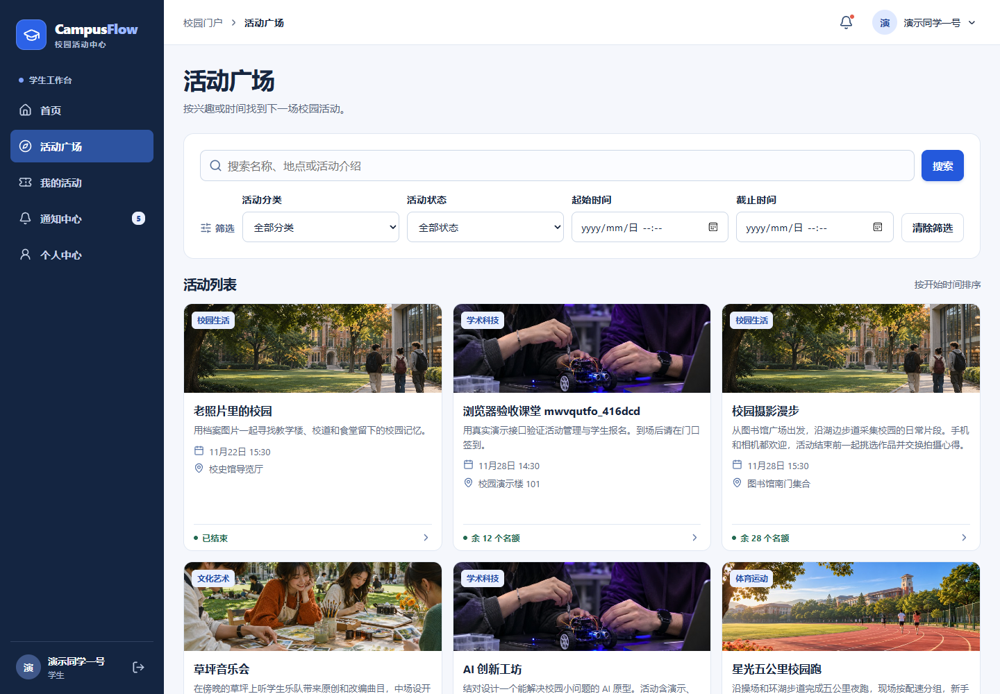
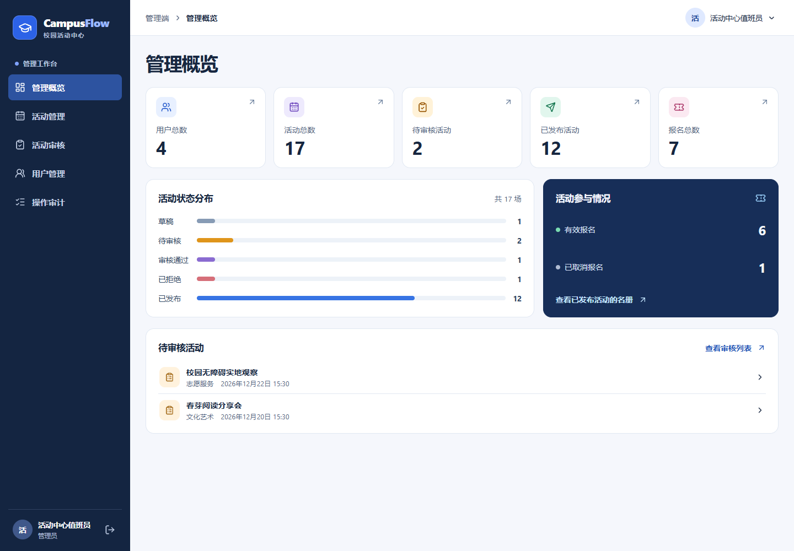
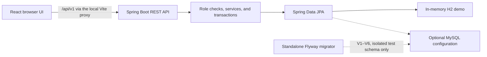

# CampusFlow

[English](README.md) · [简体中文](README.zh-CN.md)

**v0.2.0 · Local demo and educational full-stack project**

CampusFlow is a campus activity management application. Students discover activities and manage their enrollments. Administrators manage the activity lifecycle and review participation. The application interface is in Simplified Chinese.

The supported local demo uses an in-memory H2 database and fictional data. Production deployment remains unverified.

## What you can do

| Student workspace | Administrator workspace |
| --- | --- |
| Register, sign in, and edit your profile | Create and edit activity drafts, submit them for review, approve or reject submissions, and publish approved activities |
| Browse, search, and filter published activities | Inspect enrollment rosters and participation statistics |
| Enroll, cancel enrollment, and view enrollment history | Search users, inspect account details, and disable or re-enable accounts |
| Read notifications and mark them as read | Review operation logs and activity audit records |

The API enforces role and resource ownership checks. Enrollment changes use database transactions and concurrency controls.

## Screenshots

The screenshots show the application running with fictional H2 demo data.

| Student activity discovery | Administrator dashboard |
| --- | --- |
|  |  |

## Stack and architecture

- **Frontend** · React, React Router, TypeScript, and Vite
- **Backend** · Java 25, Spring Boot, Spring Data JPA, Spring Security, JWT authentication, and BCrypt password hashing
- **Data** · Flyway migrations, H2 for the local demo and persistence tests, and MySQL Connector/J for optional MySQL configurations



## Run the local demo on Windows

You need JDK 25, Node.js 20.19 or later in the 20.x series or Node.js 22.12 or later, and npm. The repository includes the Maven Wrapper pinned to Maven 3.9.16. The Windows launcher can use an installed Maven or fall back to the wrapper. On a fresh checkout the wrapper downloads and verifies its checksum-pinned bootstrap JAR. First-time setup requires access to the configured Maven and npm repositories.

From the repository root in PowerShell, start the demo and open the local account details.

```powershell
.\scripts\Start-CampusFlow-Demo.cmd
.\scripts\Open-CampusFlow-Demo-Accounts.cmd
```

Open [the demo](http://127.0.0.1:5173). The backend listens on loopback at port 18087 and exposes a [demo health endpoint](http://127.0.0.1:18087/api/v1/demo/health).

| Fictional username | Role |
| --- | --- |
| `demo_student` | Student |
| `demo_student2` | Second student for trying account isolation |
| `demo_admin` | Administrator |

The launcher generates passwords on first start and saves them under `.campusflow-demo/`. These accounts are for this local H2 demo. Keep the generated credentials private and use independent passwords and a securely generated JWT signing key for any separate deployment.

```powershell
.\scripts\Stop-CampusFlow-Demo.cmd
.\scripts\Reset-CampusFlow-Demo.cmd
```

Stopping the backend clears the in-memory business data. Start it again to restore the fictional seed data. The reset command is optional and requires a stopped demo. See the [demo guide](docs/LOCAL-DEMO.md) for a short walkthrough.

## Build and test

Run these commands from the repository root.

```powershell
.\mvnw.cmd test
.\mvnw.cmd package
.\mvnw.cmd -Pdemo package
.\mvnw.cmd -f tools/campusflow-test-migrator/pom.xml test

npm --prefix frontend ci
npm --prefix frontend run typecheck
npm --prefix frontend run build
```

The standard backend package is `target/campusflow-0.2.0.jar`. The demo package is `target/demo-build/campusflow-demo.jar`. To start only the H2 backend, run `.\scripts\Start-CampusFlow-Demo.cmd -BackendOnly`. Run `npm --prefix frontend run dev` in a separate terminal to start the frontend against that backend. On macOS and Linux, use `./mvnw` for the Maven build and test commands.

With the complete H2 demo running and Microsoft Edge installed, run the browser acceptance suite from the repository root.

```powershell
npm --prefix frontend run test:e2e
```

The earlier acceptance baseline was 101 application tests, 58 standalone migrator tests, and 16 browser checks. These counts describe historical runs. See the [build guide](docs/BUILD.md) for commands, outputs, and browser test requirements.

## Database support and limits

- **H2 demo.** Flyway applies V1–V8 to a disposable, in-memory H2 database, and the demo profile seeds fictional accounts and activities.
- **MySQL validation.** An earlier isolated MySQL 9.7.2 environment passed V1–V6 migration and schema checks, 16 groups of HTTP checks, an application restart, and SQL verification. V7 and V8 have been verified on H2 only. This public release was verified without connecting to a real MySQL server. Full MySQL production deployment remains unvalidated.
- **Standalone migrator.** The guarded Flyway module handles V1–V6 for a dedicated local MySQL test schema. The current application expects the V8 schema. The V6 migrator by itself leaves the current application schema incomplete.

The public [configuration template](application-local.example.yml) has placeholders for optional MySQL profiles. See the [database guide](docs/DATABASE.md) for profile boundaries, secret handling, and the offline migrator preflight.

## Repository layout

```text
src/main/java/                     Spring Boot API and demo seeding
src/main/resources/                App profiles and V1–V8 SQL migrations
src/test/                          Application tests
frontend/src/                      React student and administrator workspaces
frontend/e2e/                      Browser acceptance script
scripts/                           Windows demo launcher and lifecycle commands
tools/campusflow-test-migrator/     Standalone Flyway V6 test migrator
docs/                              Build, database, demo guides, and screenshots
```

## Security, privacy, and licensing

The demo is designed for loopback access and disposable data. Keep database passwords, JWT signing keys, generated demo credentials, logs, and data exports out of source control. Browser-side configuration, including any `VITE_` variables, is visible to the client and must contain no secrets. See the [security policy](SECURITY.md) for private reporting and redaction guidance.

CampusFlow's original code is available under the [MIT License](LICENSE). Third-party components retain their original licenses. See the [third-party notices](THIRD-PARTY-NOTICES.md).
