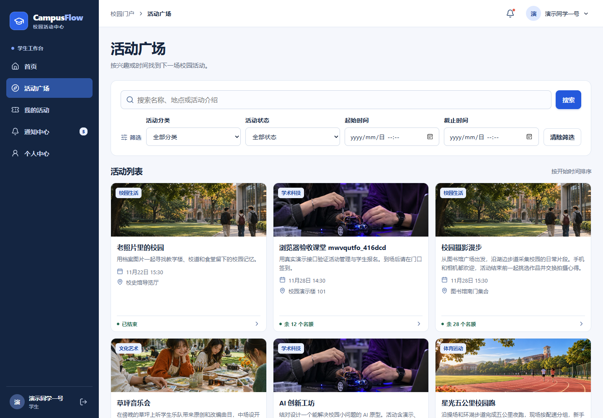
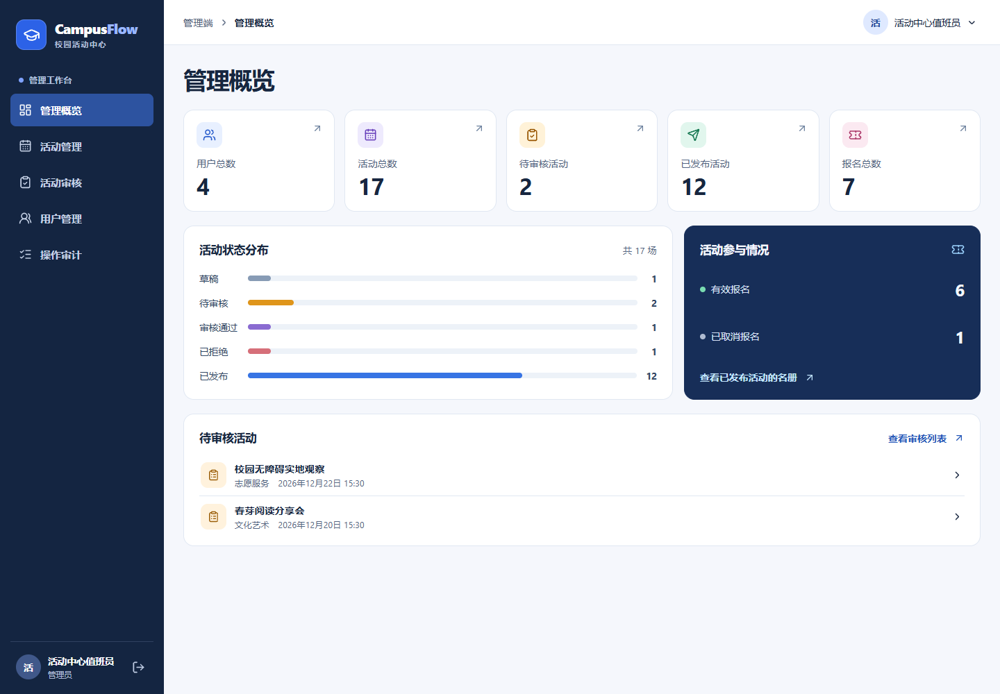
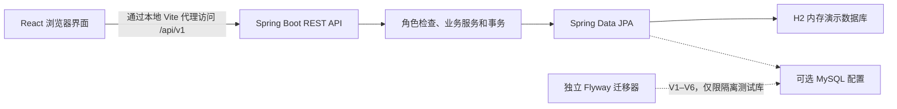

# CampusFlow

[English](README.md) · [简体中文](README.zh-CN.md)

**v0.2.0 · 本地演示与教学用途的全栈项目**

CampusFlow 是一款校园活动管理应用。学生可以查找活动并管理自己的报名，管理员可以管理活动流程并查看参与情况。当前应用界面使用简体中文。

本地演示使用 H2 内存数据库和虚构数据。生产部署尚未完成验证。

## 核心功能

| 学生端 | 管理员端 |
| --- | --- |
| 注册、登录和编辑个人资料 | 创建和编辑活动草稿、提交审核、审核通过或驳回，以及发布已通过审核的活动 |
| 浏览、搜索和筛选已发布的活动 | 查看报名名册和参与统计 |
| 报名、取消报名和查看报名记录 | 搜索用户、查看账号详情、禁用或恢复账号 |
| 查看通知和标记已读 | 查看操作日志和活动审计记录 |

后端 API 检查用户角色和资源归属。报名变更使用数据库事务和并发控制。

## 界面截图

截图来自使用虚构 H2 演示数据运行的实际应用。

| 学生端活动广场 | 管理员工作台 |
| --- | --- |
|  |  |

## 技术栈与系统架构

- **前端** · React、React Router、TypeScript 和 Vite
- **后端** · Java 25、Spring Boot、Spring Data JPA、Spring Security、JWT 身份认证和 BCrypt 密码哈希
- **数据层** · Flyway 管理迁移，H2 用于本地演示和持久层测试，MySQL Connector/J 用于可选的 MySQL 配置



## 在 Windows 上运行本地演示

需要 JDK 25、Node.js 20.19 及以上的 20.x 版本或 Node.js 22.12 及以上版本，以及 npm。项目附带固定为 Maven 3.9.16 的 Maven Wrapper。Windows 启动器可使用已安装的 Maven，也可使用 Wrapper。全新检出时，Wrapper 会下载引导 JAR 并校验固定的 SHA-256。首次配置需要访问指定的 Maven 和 npm 仓库。

在项目根目录的 PowerShell 中启动演示并打开本地账号信息。

```powershell
.\scripts\Start-CampusFlow-Demo.cmd
.\scripts\Open-CampusFlow-Demo-Accounts.cmd
```

打开[本地演示](http://127.0.0.1:5173)。后端监听本机回环地址的 18087 端口，并提供[演示健康检查](http://127.0.0.1:18087/api/v1/demo/health)。

| 虚构用户名 | 角色 |
| --- | --- |
| `demo_student` | 学生 |
| `demo_student2` | 第二名学生，可用于体验账号间的资源隔离 |
| `demo_admin` | 管理员 |

启动器在首次运行时生成密码，存放于 `.campusflow-demo/`。这些账号仅用于当前本地 H2 演示。请妥善保管生成的凭据。单独部署时应设置独立密码并生成安全的 JWT 签名密钥。

```powershell
.\scripts\Stop-CampusFlow-Demo.cmd
.\scripts\Reset-CampusFlow-Demo.cmd
```

停止后端会清空内存中的业务数据，再次启动会重建虚构演示数据。重置命令为可选操作，需要先停止演示。体验步骤见[本地演示指南](docs/LOCAL-DEMO.md)。

## 构建与测试

在项目根目录执行以下命令。

```powershell
.\mvnw.cmd test
.\mvnw.cmd package
.\mvnw.cmd -Pdemo package
.\mvnw.cmd -f tools/campusflow-test-migrator/pom.xml test

npm --prefix frontend ci
npm --prefix frontend run typecheck
npm --prefix frontend run build
```

标准后端构建产物为 `target/campusflow-0.2.0.jar`，演示构建产物为 `target/demo-build/campusflow-demo.jar`。使用 `.\scripts\Start-CampusFlow-Demo.cmd -BackendOnly` 可单独启动 H2 后端。另开终端执行 `npm --prefix frontend run dev` 即可启动连接该后端的前端。在 macOS 和 Linux 上，Maven 构建与测试命令使用 `./mvnw`。

完整的 H2 演示正在运行且已安装 Microsoft Edge 时，从项目根目录运行浏览器验收。

```powershell
npm --prefix frontend run test:e2e
```

此前的验收基线为 101 项应用测试、58 项独立迁移器测试和 16 项浏览器检查。这些数字来自历史验收。命令、构建产物和浏览器测试要求见[构建指南](docs/BUILD.md)。

## 数据库支持与验证边界

- **H2 演示。** Flyway 将 V1–V8 迁移应用到一次性 H2 内存数据库，演示配置会创建虚构账号和活动。
- **MySQL 验收。** 早期隔离的 MySQL 9.7.2 环境通过了 V1–V6 迁移及结构检查、16 组 HTTP 检查、应用重启和 SQL 复核。V7、V8 仅在 H2 上完成验证。本次公开发布未连接真实 MySQL。完整 MySQL 生产部署仍未通过最终验收。
- **独立迁移器。** 带安全保护的 Flyway 模块只对专用本地 MySQL 测试库运行 V1–V6。当前应用需要 V8 数据库结构，仅运行 V6 迁移器无法满足当前应用的结构要求。

公开[配置模板](application-local.example.yml)提供可选 MySQL 配置的占位符。配置隔离、凭据要求和迁移器离线预检见[数据库指南](docs/DATABASE.md)。

## 项目结构

```text
src/main/java/                     Spring Boot API 和演示数据初始化
src/main/resources/                应用配置和 V1–V8 SQL 迁移
src/test/                          应用测试
frontend/src/                      React 学生端和管理员端
frontend/e2e/                      浏览器验收脚本
scripts/                           Windows 演示启动、停止及重置脚本
tools/campusflow-test-migrator/     独立 Flyway V6 测试库迁移器
docs/                              构建、数据库、演示指南和截图
```

## 安全、隐私与许可

演示面向本机回环访问，使用可丢弃的数据。请勿提交数据库密码、JWT 签名密钥、生成的演示凭据、日志和数据导出。浏览器端配置对客户端可见，包括 `VITE_` 变量，因此其中不能存放秘密。私密反馈和脱敏方法见[安全政策](SECURITY.md)。

CampusFlow 自有代码采用 [MIT 许可证](LICENSE)。第三方组件仍遵循各自的原有许可，详见[第三方声明](THIRD-PARTY-NOTICES.md)。
